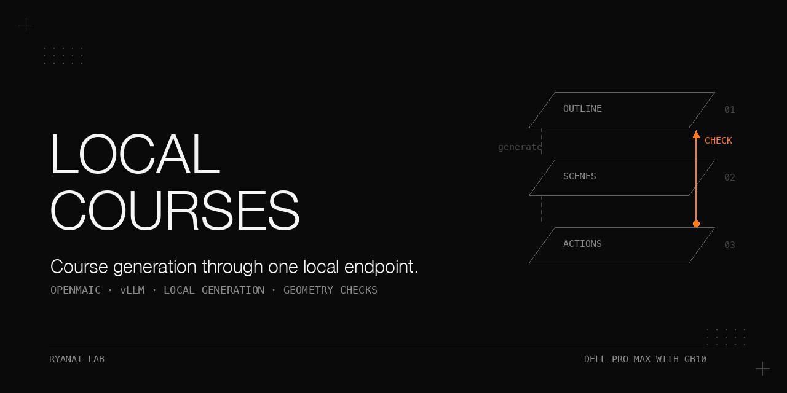

# OpenMAIC on one local vLLM endpoint - Dell Pro Max with GB10

OpenMAIC generated a complete seven-scene course through a local OpenAI-compatible
endpoint, with **zero cloud keys in the configuration file** and no engine source
patch. In the single run on 2026-09-12, generation took **56.5 minutes** for a planned
**10-minute** course: five slides, one interactive diagram and one quiz, with four
roles and text narration actions. The model server used two Dell Pro Max with GB10
machines. The server log also reported a second provider loaded from an unexplained
source. All logged generation calls selected the local model, but the process's
complete configuration and browser egress were not audited. This is a feasibility
and gap-finding study, not proof of a fully isolated deployment or a benchmark.

## Why this matters

A local model can satisfy the engine's structured-generation contract without a
source fork. The harder questions start after the endpoint connects: whether the
client uses available concurrency, whether valid JSON produces readable slides,
who can use the application, and whether playback reaches outside the machine.

Here, the default generation loop was serial, one slide had stacked text boxes,
the shared access code was disabled, and the interactive page referenced a public
CDN. The useful result is a working generation path plus specific missing checks.
The small offline tools in this repository make those checks repeatable without
publishing the original course, its prompt, its role personas or its logs.

## What is in this book

1. [Endpoint wiring](docs/endpoint-wiring.md): configure the provider slot and separate file evidence from process evidence.
2. [Generation timing](docs/generation-timing.md): account for the serial calls and interpret sampled endpoint counters.
3. [Course artifacts](docs/course-artifacts.md): inspect scene structure, action counts and storage sizes without content claims.
4. [Layout validation](docs/layout-validation.md): detect overlapping text boxes and elements outside the canvas.
5. [Access and playback](docs/access-and-playback.md): distinguish shared-code gating, browser storage and CDN dependencies.
6. [Extraction and export](docs/extraction-and-export.md): recover browser records and document the uncompleted export routes.

[Complete results](docs/results.md) retain the conditions and qualifiers.
[Expanded pitfalls](docs/pitfalls.md) connect symptoms to supported fixes.

## The setting

Conditions: one course on 2026-09-12; the classic home-page generator, not the Pro workbench.

| Component | Recorded setting |
|---|---|
| Engine | OpenMAIC 1.0.1; changelog dated 2026-09-06; upstream main commit `d5be393`, committed 2026-09-11; depth-1 checkout |
| Framework | Next.js 16.2.11, Turbopack dev server, React 19.2.3 |
| SDK dependencies | `ai` `^6.0.168`, `@ai-sdk/openai` `^3.0.84`; declared ranges, not independently resolved versions |
| Toolchain | Node v22.22.3; requirement `>=22.19.0`, `.nvmrc` 22; pnpm 11.2.2 used although `packageManager` pins `pnpm@10.28.0`; no error observed |
| Installation | `pnpm install` completed; `node_modules` was 2.3 GB |
| Engine host | An Apple-silicon Mac desktop |
| Model server | Two Dell Pro Max with GB10 machines, vLLM tensor-parallel 2, DeepSeek V4 Flash Vision-Exp, served as `deepseek-v4-flash-vision-exp` |
| Endpoint mode | Fast-tier proxy injected `chat_template_kwargs: {"thinking": false}`; request-body confirmation was not captured |
| Storage and voice | Browser IndexedDB; no database, TTS or ASR service; narration remained text; Docker was not used for generation |
| Run window | 2026-09-12, 18:38 to 19:42 local time; generation 18:40 to 19:37; extraction 19:41 |

The serving image and weights revision are described in the
[model-serving cookbook](https://github.com/ryangu00/dell-pro-max-gb10-deepseek-v4-flash-vision-exp).
They are not independently specified here. The endpoint's engine and model tier
were replaced after this run, and the model name later became an alias.
These measurements apply to the recorded deployment, not to that alias today.

OpenMAIC is the public, MIT-licensed project by THU-MAIC, Tsinghua University:
[THU-MAIC/OpenMAIC](https://github.com/THU-MAIC/OpenMAIC).
The accompanying public credit is *From MOOC to MAIC*, Journal of Computer Science
and Technology, 2026. This cookbook has its own Apache-2.0 license.

## Chapter 1 - Wire the engine to one local endpoint

**Problem.** The provider loader expects a non-empty credential even when the
OpenAI-compatible endpoint does not require one. A configured URL alone does not
activate the `deepseek` provider slot.

**Mechanism.** The dummy value activates the provider; the server-side base URL
selects the endpoint. `DEFAULT_MODEL` uses `provider:model` syntax for every stage
unless the JSON `MODEL_ROUTES` setting overrides it. The shipped example contains
four assignments; replace the placeholders before use.

```dotenv
DEEPSEEK_API_KEY=local-placeholder
DEEPSEEK_BASE_URL=http://127.0.0.1:<port>/v1
DEEPSEEK_MODELS=<served-model>
DEFAULT_MODEL=deepseek:<served-model>
```

The catalog at the recorded commit knows `deepseek-v4-flash-vision-exp`: context
window 1,048,576, output window 393,216, vision enabled, thinking toggleable and on
by default. Generation passes the catalog output window as `maxOutputTokens`.
An unknown model name has no explicit output limit supplied by this mechanism.
The server-side base URL worked without `ALLOW_LOCAL_NETWORKS=true`; that setting
addresses client-supplied private addresses. See the chapter for the SSRF boundary.

**Procedure as run.** Install upstream dependencies, probe the model-list route
and a small chat completion, write `.env.local`, then start `pnpm dev` with its
output redirected to a log. Disable framework telemetry with
`npx next telemetry disable`. Submit through the classic home-page generator and
sample endpoint metrics while watching application generation events.
The original prompt and log are not reproduced here.

Conditions: 2026-09-12, n=1 course; these are separate evidence layers, not an egress audit.

| Layer | Result and limit |
|---|---|
| File | Four assignments; zero cloud-key lines in the file check at 18:38; process environment not captured |
| UI | One model under a server-managed DeepSeek provider; observed once, no saved capture |
| Application | All 16 generation events selected `deepseek:deepseek-v4-flash-vision-exp`; application error and warning counts were 0 |
| Endpoint | Running requests 1.0 in all 30 one-minute samples; waiting 0.0 in direct probes at 18:41 and 18:47; no other endpoint user during the run |
| Unresolved provider | Server reported 2 LLM providers twice, at 18:38:40 and 18:39:25; source of the second was never identified |

**What did not work or was not established.** The application does not log outbound
request URLs. A log without cloud hosts therefore proves little. No request body
was captured to reconcile the engine's DeepSeek-style thinking fields with the
proxy's chat-template flag. Browser-side egress was not audited.

**Rule.** Claim zero cloud keys in the configuration file only. A stronger process
claim requires a clean-environment rerun and inspection of `/api/server-providers`.
That rerun was not performed.

## Chapter 2 - Account for the generation time

**Problem.** A long pause can mean either a stuck pipeline or a long model call.
The client request sequence determines whether a server can batch work.

**Mechanism.** The browser requests an outline and role profiles, then requests
content followed by actions for each scene before advancing. The recorded scene
branches each made one model call per HTTP request. The retry layer exists, but
the record shows 7 content POSTs and 7 action POSTs, with no retry.

`PARALLEL_SCENE_CONCURRENCY` is clamped to 0 to 10; its default 0 selects serial
generation. The optional path parallelizes content only; actions remain serial.
It was not enabled. Its untested estimate appears under Limits below.

**Procedure as run.** Generation began at 18:40:24 and ended at 19:36:54.
The monitor sampled token totals and running requests once a minute for 30 minutes.
A later idle monitor waited for consecutive zero-running observations and counted
scene starts. Discard the progress monitor's first cumulative token delta.

Conditions: n=1 course, 2026-09-12; stage timings from timestamps and POST durations.

| Stage / scene | Type | Start | Content call | Actions call | Scene total | Actions emitted |
|---|---|---|---|---|---|---|
| Outline | Structured JSON, streamed | 18:40:24 | 3.66 min (219 s; POST duration rounded to 3.6 min) | | 3.66 min | |
| Role profiles (4 roles) | | 18:44:04 | 61 s | | 1.02 min | |
| Scene 1 | slide | 18:45:08 | 358 s (6.0 min) | 43 s | 6.7 min | 8 |
| Scene 2 | interactive diagram | 18:51:54 | 668 s (11.1 min) | 66 s | 12.2 min | 8 |
| Scene 3 | slide | 19:04:08 | 216 s (3.6 min) | 90 s | 5.1 min | 9 |
| Scene 4 | slide | 19:09:15 | 443 s (7.4 min) | 120 s | 9.4 min | 11 |
| Scene 5 | slide | 19:18:37 | 560 s (9.3 min) | 144 s | 11.7 min | 9 |
| Scene 6 | slide | 19:30:21 | 234 s (3.9 min) | 83 s | 5.3 min | 10 |
| Scene 7 | quiz | 19:35:39 | 62 s (1.0 min) | 14 s | 1.3 min | 1 |
| Total | | 18:40:24 to 19:36:54 | | | 56.5 min | 56 |

Conditions: arithmetic on the same course and sampled counters at 18:48 to 19:18.

| Quantity | Result |
|---|---|
| Content / actions / outline plus roles | 42.35 min (75%) / 9.33 min (16.5%) / 4.7 min (8.3%) |
| Decode rate, 30 samples | Median 48 tok/s; mean 49 tok/s; range 39 to 76 tok/s |
| Between-scene gaps | 0.01 to 0.02 s five times; 4.6 s once, including a 4.3 s classroom-route load |
| Whole-run tokens, estimate | About 166,000, extrapolated from the 30-sample mean across 56.5 min; not a measured total |

**What did not work or was not done.** No second course or thinking-on comparison
was run. Slide content times varied 2.6x within this course. Cumulative endpoint
counters alone cannot attribute tokens or finish reasons to an individual course.
The large gap between generated-token estimates and retained bytes is unexplained.

**Rule.** Inspect the client's request pattern before treating generation time as
a shortage of compute. Batch headroom is bounded by measured aggregate throughput.

## Chapter 3 - Inspect what comes out

**Problem.** A completed generation needs an inspectable artifact contract.
The original course content cannot serve as a public fixture.

**Mechanism.** Browser storage holds stage metadata, outline records and scene
records. Slides use absolute canvas coordinates; action lists refer to element
identifiers; the interactive scene carries HTML; the quiz carries questions and
explanations. Export by `order`, not random storage keys.

**Procedure as run.** Read the records from IndexedDB, save them through the
loopback receiver, then inspect structure and counts. Quality was judged by one
reader without a rubric or a second reader. No course text is quoted here.

Conditions: n=1 course, extracted 2026-09-12 at 19:41; structural observations only.

| Artifact | Recorded structure |
|---|---|
| Stage | One record, 4 role configurations: 1 teacher, 1 assistant, 2 students; DSL 0.3.0 |
| Outline | 7 items; estimated teaching duration 60 to 120 s each, totaling 600 s |
| Slides | 5 scenes; 1000 by 562.5 canvas, ratio 0.5625; 3 to 14 elements per slide |
| Actions | 56 total: 21 spotlight, 28 speech, 6 widget_reveal, 1 discussion |
| Interactive | One diagram, 6 nodes, reveal order, HTML page of 24,749 characters with inline script |
| Quiz | 3 questions: 1 single-choice at 10 points, 2 multiple-choice at 15 points each; 4 options each; 40 points total |
| Saved JSON | 9 files, 75,530 B; individual sizes in the complete results |

**What did not work or was not done.** Structure fidelity and cross-scene continuity
were single-reader observations. Classroom playback was inspected through
screenshots only. There was no scoring rubric, cloud-model comparison, narration
audio or learner-side playback audit. The public fixtures are handwritten contract
tests, not a newly generated course or evidence of teaching quality.

**Rule.** Separate schema and structure checks from editorial judgement, and state
the number of readers and courses behind any quality claim.

## Chapter 4 - Add a deterministic layout gate

**Problem.** Valid slide JSON can still place several text boxes at the same point.
The normalizer repairs fields and types, not layout.

**Mechanism.** The supplied checker intersects each pair of text rectangles and
divides intersection area by the smaller rectangle's area. It reports a collision
at 20% or greater, annotates identical origins, and checks every element against
the fixed 1000 by 562.5 canvas. Background shapes do not create text collisions.

**Procedure as run.** Inspect each slide's element positions and dimensions,
compute pairwise intersections, and compare bounds. The shipped checker preserves
that logic unchanged; synthetic fixtures exercise both failure classes offline.

Conditions: n=5 slides from the 2026-09-12 course; geometry check, not a rendered-text test.

| Slide | Elements | Text-box overlap findings | Out of canvas |
|---|---|---|---|
| Scene 1 | 7 | 0 | 0 |
| Scene 3 | 3 | 0 | 0 |
| Scene 4 | 6 | 0 | 0 |
| Scene 5 | 13 | 6 pairs, all 100% overlap, identical origin | 0 |
| Scene 6 | 14 | 0 | 0 |

The failing three-column layout placed its backgrounds correctly but collapsed
three titles and three bodies into separate stacks. Both groups failed, not just
the titles. Another slide used the same arrangement correctly. One failing slide
in five is 20% for this course, with a very wide interval, not a general rate.

```bash
python3 scripts/layout_check.py --selftest
python3 scripts/layout_check.py fixtures/scene-clean.json
python3 scripts/layout_check.py fixtures/scene-overlap.json  # expected exit 1
```

**What did not work or was not done.** The check cannot see text overflowing its
box, contrast, or unreadable font size. A model repair pass was not attempted.
Upstream's whiteboard geometry detector does not validate this slide path.

**Rule.** Apply a deterministic geometry gate before export; schema validity alone
is insufficient. A feedback-and-repair loop remains an experiment.

## Chapter 5 - Separate access control from local playback

**Problem.** A shared code is not per-user identity, and local generation does not
make the generated page's dependencies local.

**Mechanism.** An unset `ACCESS_CODE` lets requests through. When enabled, code
verification sets an `HttpOnly`, `SameSite=Lax` cookie named `openmaic_access`,
with a 7-day browser lifetime and `Secure` only in production. Its value contains
a timestamp and an HMAC-SHA256 signature keyed by the code. The server verifies
the signature, not the age of the embedded timestamp.

API routes require the valid cookie; pages pass through to a front-end modal.
Health and access-code routes are exempt. Default course persistence is IndexedDB.
The optional PostgreSQL profile is separate and offers no user isolation through
its browser-visible development token.

**Procedure as run.** Leave the access code unset, inspect the recorded source,
and inspect the exported artifact for external URLs. Authentication was not
dynamically exercised. These findings apply to the recorded commit.

Conditions: source reading plus observations from the 2026-09-12 run; no dynamic authentication test.

| Item | Finding |
|---|---|
| Access code | Not set; the development server advertised network reachability and allowed all routes |
| Identities with shared code | 1: everyone with the code is indistinguishable |
| Storage | Browser IndexedDB only; no database started |
| Interactive dependencies | 3 KaTeX 0.16.9 asset URLs on `cdn.jsdelivr.net`; the 5 slides and quiz had no external URL |

**What did not work or was not done.** No identity-aware reverse proxy, forgery
test, brute-force test, rate-limit test or browser egress audit was performed.
CDN-blocked rendering was not tested. The supplied rewrite helper changes asset
URLs only; it neither downloads KaTeX nor establishes offline rendering.

**Rule.** Authenticate the whole app for shared use, and verify local generation
and local playback separately. Those deployment changes are not validated here.

## Chapter 6 - Recover records before promising exports

**Problem.** The browser held the only course copy, and the export clicks did not
produce downloadable files in the test browser.

**Mechanism.** Read `stages`, `outlines` and `scenes` from `maic-documents` into a
window variable, then POST each record to a receiver bound to loopback. The
published receiver takes an output directory and accepts only filenames matching
`[A-Za-z0-9_-]+`. Its CORS origin must equal the application's origin.

**Procedure as run.** Inspect database stores, find the populated document
database, start the receiver, post the records, stop it, and verify content
signatures rather than file sizes alone. Then attempt the menu export routes and
inspect the separate video-render service prerequisites.

Conditions: n=1 course, extraction at 19:41 on 2026-09-12; no exported presentation or video artifact.

| Item | Outcome |
|---|---|
| Course data | 9 JSON files, 75,530 B, verified by record content and structure |
| Receiver | Loopback-only; up for under 20 seconds |
| MP4 | Not produced: missing compose support/runtime, absent standalone prerequisites, service memory gate |
| PPTX / resource-pack / classroom ZIP | No file arrived; browser download blocking was the recorded explanation, not independently confirmed |

**What did not work or was not done.** The video capability was disabled. The
container route could not start, and the standalone renderer was not ready.
Hyperframes CLI 0.7.60 and FFmpeg 8.1.1 were present, but no manual render was run.
An upstream PPTX exporter and a menu item do not establish a successful export.

**Rule.** Recover and validate browser records first. Record an uncompleted export
as uncompleted, even when a plausible implementation path exists.

## Pitfalls

Conditions: symptoms from the recorded run or source inspection; full mechanisms and evidence in [the expanded guide](docs/pitfalls.md).

| Symptom | Root cause | Fix or next check |
|---|---|---|
| Provider listing returns 404 | Wrong route | Use `/api/server-providers`; app health is `/api/health` |
| Error grep fires continuously | Compile warnings contain the word error | Match application `[ERROR]` severity or generation POST results |
| Huge first token delta | Counter is cumulative | Discard the first sample as a baseline |
| Silent scene generation | Non-streaming content call | Watch token deltas instead of only the app log |
| Correct cards, stacked text | Repeated text coordinates | Run the geometry checker; inspect identical origins |
| Shared code assumed active | Opt-in setting was absent | Set it and test an unauthenticated API request for 401 |
| Playback requires internet | KaTeX CDN assets | Vendor assets and rewrite references, then test offline rendering |
| Export click produces nothing | Suspected browser download restriction | Use a normal browser or inspect IndexedDB and use the receiver |
| Growing idle log | Board polling and repeated warnings | Close the tab; the polling cause was not investigated |

## Reproduce it without our infrastructure

The offline helper checks require Python's standard library, Bash and Node's
built-in test runner. They need no GPU, installed OpenMAIC, model server or network.
Synthetic fixture constants are test inputs, never additional performance results.

1. Run `python3 -B -m unittest discover -s tests -v` and `node --test tests/test_snippets.mjs`.
2. Run the layout commands in Chapter 4. The overlap fixture deliberately fails.
3. Rewrite the HTML fixture with `python3 scripts/vendor_katex.py fixtures/interactive.html fixtures/interactive-local.html`.
   This tests substitutions only. Remove the derived file after inspection; genuine assets are not bundled.
4. For a loopback receiver check, run `python3 scripts/receiver.py --output exports`.
   In another terminal run `curl -X POST --data '{}' http://127.0.0.1:9977/test`;
   inspect `exports/test.json`, then stop the receiver. These are example defaults.
5. For a real course, obtain the recorded OpenMAIC revision and install its
   dependencies on a Mac or Linux host with Node 22.19 or newer and pnpm.
   Provision your own OpenAI-compatible endpoint; this repository does not install one.
6. Copy `configs/openmaic.env.local.example` to the engine's `.env.local`, replace
   every placeholder, and run `scripts/endpoint-smoke.sh` with `VLLM_URL` and `MODEL` set.
   `VLLM_URL` is the endpoint origin without `/v1`; `.env.local` includes `/v1`.
7. Start the application with the configured environment, inspect
   `/api/server-providers`, and use a fresh neutral course request. A clean-environment
   launch is the unrun follow-up described in Chapter 1; its complete allowlist is unspecified.
8. Run `scripts/progress-monitor.sh` with `VLLM_URL` and `DEV_LOG`; discard its
   first delta. Use `scripts/wait-until-idle.sh` for the later idle check.
   These are diagnostic source scripts, not reliable course-completion assertions.
9. Run the four console blocks in `scripts/indexeddb-export-snippets.js`, setting
   `window.OPENMAIC_RECEIVER_PORT` before the last block. Select the intended
   course records, post them to the receiver, validate structure, and check every slide.

Steps needing the actual application, browser or endpoint were not rerun for this
book. A fresh generated neutral course is not included; its timings will differ.
The HTML rewrite has not been validated with actual KaTeX files and browser playback.

## Limits and open questions

- **Single observation:** n=1 course, one model/build, one reader; no repeat-course distribution, rubric or second reader.
- **Configuration boundary:** the second loaded provider remains unidentified; the clean-environment provider check was not run.
- **Parallelism estimate, not run:** 75.8 tok/s at six concurrent short-prompt streams with 200 to 800 output tokens came from the serving study, a different workload. Scaling 42.35 minutes by 49/76 gives about 27 minutes for content and on the order of 40 minutes overall (27 + 9.3 + 4.7). Estimated headroom is about 1.5x, not a measured course speedup; the longest content call was 11.1 minutes.
- **Thinking and tokens:** the injected flag was not verified in captured requests; about 166,000 generated tokens is an extrapolation, and the gap versus 75,530 retained bytes is unexplained.
- **Optional experiments, not run:** parallel scenes, thinking-on comparison, repeat neutral courses, slide repair feedback, identity-aware proxy, dynamic authentication checks, CDN-blocked playback and manual video rendering.
- **Uncompleted output paths:** no MP4, PPTX, resource-pack or classroom ZIP; no TTS or ASR; no learner-side playback audit. Hyperframes was only version-checked locally.
- **Changed endpoint:** the later model alias and engine do not inherit these results. The old serving revision is not reconstructed here.
- **Publication boundary:** original course material and logs are absent. The banner generator is supplied but intentionally unrun, so `docs/assets/banner.png` is not yet present.

## Files

| Path | Purpose |
|---|---|
| `docs/results.md`, `docs/pitfalls.md` | Complete public tables and expanded failure analysis |
| `docs/endpoint-wiring.md`, `docs/generation-timing.md` | Provider mechanics, timing interpretation and monitor limits |
| `docs/course-artifacts.md`, `docs/layout-validation.md` | Artifact contracts and deterministic geometry |
| `docs/access-and-playback.md`, `docs/extraction-and-export.md` | Access semantics, CDN handling and extraction procedure |
| `configs/openmaic.env.local.example` | Four provider assignments with placeholders and dummy-key explanation |
| `scripts/endpoint-smoke.sh`, `scripts/vllm-metrics-probe.sh` | Model/completion smoke and metric inspection |
| `scripts/progress-monitor.sh`, `scripts/wait-until-idle.sh` | Sanitized historical monitoring logic |
| `scripts/receiver.py`, `scripts/indexeddb-export-snippets.js` | Loopback receiver and four browser-console blocks |
| `scripts/layout_check.py`, `scripts/vendor_katex.py` | Unchanged geometry checker and new URL rewriter |
| `fixtures/`, `tests/` | Handwritten inputs, standard-library tests and built-in JavaScript tests |
| `docs/make_banner.py` | Unrun house-style banner generator; Pillow required only to render it |
| `LICENSE`, `.gitignore` | Supplied repository templates |

## Related cookbooks

- [DeepSeek V4 Flash Vision-Exp serving](https://github.com/ryangu00/dell-pro-max-gb10-deepseek-v4-flash-vision-exp): the two-node model stack and the different-workload aggregate-throughput measurement.
- [Thinking-tier proxy](https://github.com/ryangu00/dell-pro-max-gb10-thinking-tier-proxy): the fast-tier chat-template flag used by the endpoint.
- [Local LLM measurement pitfalls](https://github.com/ryangu00/local-llm-bakeoff-measurement-pitfalls): distinguish a single observation, an estimate and an untested assumption.

## License

Apache-2.0. See [LICENSE](LICENSE). OpenMAIC remains a separate MIT-licensed project.
